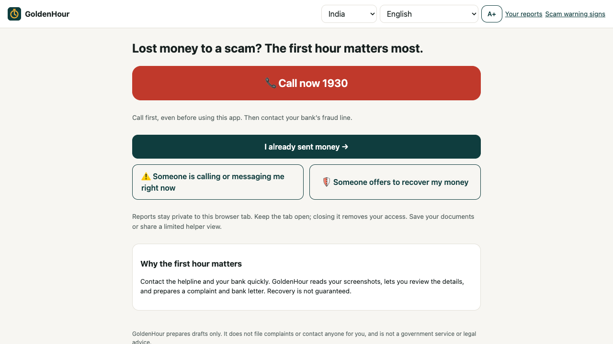
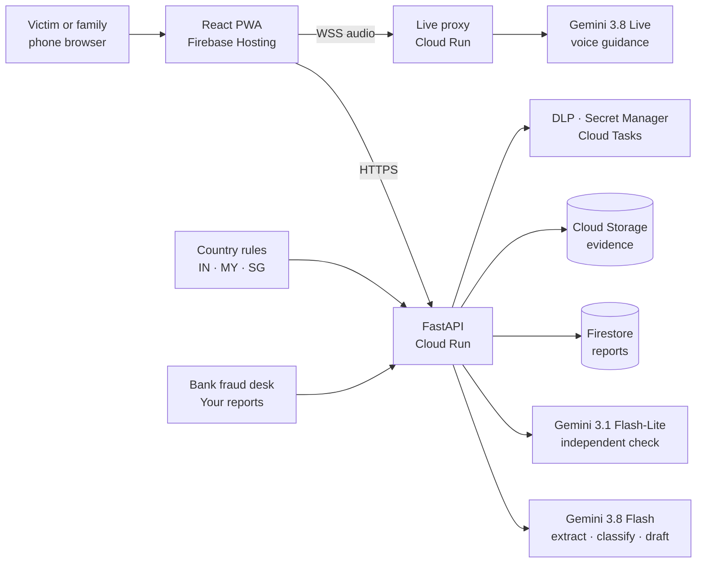

GoldenHour
==========

[](https://cloud.google.com/vertex-ai)
[](https://cloud.google.com/run)
[](LICENSE)

**The first responder for scam victims: from panic to a verified, bank-ready report in the first hour.**

GoldenHour helps people who have just sent money to a scammer, and the family members helping them. It puts the right helpline one tap away, reads bank SMS, UPI receipts and chat screenshots with Gemini, verifies every extracted value against a second independent reading, and prepares the complete complaint, helpline call script and bank letter. On the other side, bank fraud desks get reports ranked by urgency, with victims linked through the same scammer account.

*Google Cloud AI Builder Cup 2026 · Theme: BFSI, Intelligent Risk, Fraud & Financial Experiences*

**Live:** [goldenhour-aicup-2026-vk1007.web.app](https://goldenhour-aicup-2026-vk1007.web.app)



The problem
-----------

A 67-year-old in Pune gets a video call from a "CBI officer". A parcel in her name supposedly contained drugs; she is under "digital arrest" and must move her savings to an "RBI verification account". Within 45 minutes she sends ₹4.85 lakh in two UPI transfers. By the time her son finds out, the money is moving through mule accounts.

- **US$88–114 billion** was lost to scams across East and Southeast Asia, Australia and New Zealand in 2025 [1].
- **82%** of Southeast Asian victims who lost money recovered nothing; only 10% were made whole [2].
- **₹22,495 crore** was reported lost to cyber fraud in India in 2025, across 2.81 million cases [3].
- **12 hours** is the average reporting delay in Indonesia, while stolen funds move in under an hour [4].

Speed and completeness decide whether money can be held:

- India's fast-reporting system (helpline 1930 and CFCFRMS) has already prevented ₹11,000+ crore from being siphoned off [5].
- Malaysia's 24-hour National Scam Response Centre raised recovered funds from RM0.5 million to RM34 million in one year [6].
- A complaint with the correct 12-digit transaction reference can trigger a hold within the hour. By day three, almost nothing is left.

Yet in that first hour, victims are panicking, often elderly and often not English speakers. Their evidence is scattered across bank SMS, UPI receipts and chats, where balances, OTPs, refunds and masked account numbers look like transaction references. Reports arrive late and incomplete.

Why GoldenHour
--------------

Scam protection today works **before** payment. Very little helps **after** the money is gone, which is exactly when speed matters most.

| | Before payment | After payment |
|---|---|---|
| Google Scam Detection · ScamShield app · ScamMukt | Flag suspicious calls, messages and links | — |
| Bank and UPI app complaint flows (e.g. BHIM MyUPI) | — | Raise and track a complaint inside one app |
| Helplines and portals (1930 · NCRP · 997 · 1799) | — | Official reporting; the victim must supply every detail |
| **GoldenHour** | Quick "is this a scam?" check | Reads evidence from any bank or app, verifies every value, prepares the complete report, links victims for responders |

GoldenHour complements official channels rather than replacing them: it gets victims there faster, with the right details.

What it does
------------

1. **Call first.** One tap to the right channel: 1930 in India, 997 in Malaysia, the bank first and then 1799 in Singapore. Country and language are detected from the device, and helplines work even offline.
2. **Add evidence.** Upload bank SMS, UPI or DuitNow receipts, chat screenshots or statements (image, PDF or text), or type a transfer manually.
3. **Read with Gemini.** Each transfer's amount, time, transaction reference, account and recipient UPI ID or account is extracted. OTPs, balances and everyday payments are ignored.
4. **Verify independently.** A separate Gemini reading of each file confirms every value. Fields are labelled checked, read, entered by you or missing, and the exact source line is shown. Conflicting screenshots are flagged, never guessed.
5. **Explain the scam.** The scam type and red flags are explained in simple language, in English or Hindi.
6. **Confirm.** The person corrects and confirms each transfer. Nothing incomplete becomes ready.
7. **Get the complaint pack.** Ready-to-copy portal fields, a helpline call script with their own numbers, a portal-safe incident description, a bank letter and an evidence checklist.
8. **Talk it through.** Gemini Live answers by voice or text in English and Hindi: calm, short and helpline-first.
9. **Follow up.** Save the helpline acknowledgement, add deadlines to the calendar, prepare a restoration request, and share a 24-hour masked view with family.

For **bank fraud desks**, *Your reports* ranks cases by response priority (time since transfer, payment method and completeness), links victims who paid the same recipient, and drafts hold requests limited to the confirmed disputed amount.

Try it in two minutes
---------------------

The app includes fictional, watermarked evidence that runs through the real Gemini pipeline. No login or personal data is needed.

1. Open [GoldenHour](https://goldenhour-aicup-2026-vk1007.web.app) → **I already sent money**.
2. **Next: upload screenshots** → **Try fictional sample evidence** → **Fake police "digital arrest" · ₹4.85 lakh · Hindi chat** → **Read my screenshots**.
3. Review the checked values and their source lines → **These details are correct** → complaint pack.
4. Start a second report with **Fake trading group · same scammer UPI ID**.
5. Open [Your reports](https://goldenhour-aicup-2026-vk1007.web.app/console) to see both victims linked through the same recipient, then **Details** → hold request.
6. Try **Talk to GoldenHour**, and the Malaysia sample after switching the country.

Problem statement coverage
--------------------------

| BFSI theme goal | GoldenHour |
|---|---|
| Detecting and mitigating fraud or risk | Fast, complete reporting to get funds held; "is this a scam?" and recovery-scam checks; cross-victim recipient linking |
| Automating complex processes | Screenshots → verified transfers → complaint, call script, bank letter and hold-request drafts |
| Improving customer interactions | One action per screen, voice guidance, English and Hindi, large text, no login |
| Personalised, informed financial experiences | Scam-specific explanations, checklists and country rules for India, Malaysia and Singapore |

Gemini and Google Cloud
-----------------------

| Component | Role in GoldenHour |
|---|---|
| Gemini 3.8 Flash | Multimodal extraction with a strict JSON schema, scam classification, complaint narrative |
| Gemini 3.1 Flash-Lite | Independent transcription of every image and PDF, run in parallel, used to verify each value |
| Gemini 3.8 Live | Real-time voice and text guidance with tools, through a server-side WebSocket proxy |
| Agent Development Kit | Guidance agent with tools, evaluated with `adk eval` against safety rubrics |
| Cloud Run | FastAPI service and Live proxy; scales from zero to five instances |
| Firebase Hosting | Installable web app (PWA) |
| Firestore · Cloud Storage | Reports and private evidence with 30-day automatic deletion |
| Sensitive Data Protection | Redaction of personal details in shared and responder views |
| Secret Manager · Cloud Tasks | Signed helper links; OIDC-verified follow-up callbacks |

**Built-in safeguards:** uploaded content is treated as untrusted; deterministic validators check reference formats (a UPI reference is exactly 12 digits) and country rules; drafts stay incomplete until every value is confirmed; the model explains the priority score but never sets it; hold drafts cover only the disputed amount.

How it works
------------



| Folder | Contents |
|---|---|
| `api/app` | API routes, extraction and source checks, filing, responder logic, storage, Live proxy |
| `api/packs` | Country rules: helplines, portal rules, reference formats, scripts, checklists |
| `api/agents` | ADK guidance agent and evaluation set |
| `api/tests` | 78 automated tests |
| `web/src` | Reporting journey, voice, follow-up, warning signs, Your reports |
| `web/public/samples` | Fictional, watermarked sample evidence |
| `data-gen` | Generator for synthetic test screenshots |
| `eval` | Evaluation scripts and results |
| `infra` | Google Cloud provisioning and deployment |
| `docs` | User guide, deployment and evaluation |

Results
-------

Measured with real Gemini calls on a held-out set of synthetic screenshots: 40 cases, 78 transfers, six bank SMS formats, UPI and DuitNow receipts, Hindi, English and Malay chats, and decoy OTPs, balances and everyday payments.

| Field | Verified correctly |
|---|---|
| Transaction reference | 78 / 78 |
| Amount | 78 / 78 |
| Recipient UPI ID or account | 65 / 78 |
| Invented references | 0 |

A live end-to-end run on Cloud Run (5 screenshots: 2 bank SMS, 2 UPI receipts, 1 Hindi chat) takes about 45 seconds, with every value verified. Model cost is about US$0.026 per report. Details: [docs/EVALUATION.md](docs/EVALUATION.md).

Run it
------

**Needs:** Python 3.12, Node 20+, and a Google Cloud project with Vertex AI enabled.

1. Start the API:

   ```bash
   cd api
   python3.12 -m venv .venv && source .venv/bin/activate
   pip install -r requirements.txt
   cp .env.example .env              # set GCP_PROJECT
   gcloud auth application-default login
   uvicorn app.main:app --reload --port 8080
   ```

2. Start the web app in a second terminal, then open http://localhost:5173:

   ```bash
   cd web && npm ci && npm run dev
   ```

3. Run the tests:

   ```bash
   (cd api && .venv/bin/python -m pytest -q)
   (cd web && npm run build)
   ```

**Configuration** (`api/.env`)

| Variable | Default | Purpose |
|---|---|---|
| `GCP_PROJECT` | — | Google Cloud project |
| `GCP_LOCATION` | `us` | Vertex AI model endpoint |
| `MODEL_MAIN` | `gemini-3.8-flash` | Extraction, classification, drafting |
| `MODEL_LITE` | `gemini-3.1-flash-lite` | Independent verification |
| `MODEL_LIVE` | `gemini-3.8-live` | Voice guidance |
| `STORE_BACKEND` | `memory` | `memory` locally, `firestore` in the cloud |

**Deploy to Google Cloud.** `infra/setup.sh` provisions APIs, Firestore, the evidence bucket, secrets, the task queue, IAM and a budget alert. `infra/deploy.sh` deploys the API to Cloud Run and the web app to Firebase Hosting. See [docs/DEPLOYMENT.md](docs/DEPLOYMENT.md).

```bash
PROJECT=your-project REGION=us-central1 BUDGET_ACCOUNT=your-billing-account bash infra/setup.sh
PROJECT=your-project REGION=us-central1 MODEL_LOCATION=us \
  MODEL_MAIN=gemini-3.8-flash MODEL_LITE=gemini-3.1-flash-lite \
  MODEL_LIVE=gemini-3.8-live MODEL_LIVE_FALLBACK=gemini-3.8-live bash infra/deploy.sh
```

Future plan
-----------

- **Bank pilot:** GoldenHour as a bank's 24/7 scam-reporting front door. Singapore's Shared Responsibility Framework already requires banks to provide one [7].
- **Direct intake:** structured handoff APIs with national reporting centres (1930/CFCFRMS, NSRC, Anti-Scam Command), so verified reports reach responders without retyping.
- **WhatsApp and SMS:** start a report and receive deadline reminders on the channels victims already use.
- **More countries and languages:** Indonesia (IASC), Thailand and the Philippines, plus Tamil, Bengali and Bahasa Indonesia.
- **Read-aloud mode:** the call script spoken in the victim's language while they are on the helpline.
- **User studies:** measure report preparation time and errors with families and bank teams to guide the next release.

Credits
-------

**Built with** [Gemini](https://deepmind.google/technologies/gemini/) · [Vertex AI](https://cloud.google.com/vertex-ai) · [Agent Development Kit](https://google.github.io/adk-docs/) · [Cloud Run](https://cloud.google.com/run) · [Firebase](https://firebase.google.com) · [Firestore](https://cloud.google.com/firestore) · [Sensitive Data Protection](https://cloud.google.com/sensitive-data-protection) · [FastAPI](https://fastapi.tiangolo.com) · [React](https://react.dev) · [Vite](https://vite.dev)

Sources
-------

1. [UNODC: Transnational Organized Crime Threat Assessment, South-East Asia 2026](https://www.unodc.org/unodc/en/press/releases/2026/July/new-unodc-report-reveals-scale-of-south-east-asias-ever-more-interconnected-criminal-economy.html)
2. [GSMA: ASEAN Consumer Scam Report 2026](https://www.gsma.com/newsroom/press-release/nearly-half-of-reported-scam-incidents-go-unresolved-across-southeast-asia-undermining-digital-trust-new-gsma-findings-reveal/)
3. [ThePrint: Indians lost Rs 22,495 crore to cyber fraud in 2025](https://theprint.in/india/cybercrime-saw-24-spike-in-2025-indians-lost-rs-22495-crore-mainly-in-investment-scams/2859930/)
4. [Kompas: More than 90 percent of fraud victims' funds could be lost](https://www.kompas.id/artikel/en-lebih-dari-90-persen-dana-korban-penipuan-berpotensi-raib)
5. [IMPRI: Citizen Financial Cyber Fraud Reporting and Management System](https://www.impriindia.com/insights/policy-update/citizen-financial-cyber-fraud-reporting-and-management-system-cfcfrms-strengthening-indias-response-to-digital-financial-fraud/)
6. [Malay Mail: 24-hour National Scam Response Centre increased money recovery in 2025](https://www.malaymail.com/news/malaysia/2026/01/27/saifuddin-nasution-24-hour-national-scam-response-centre-increased-money-recovery-6700pc-in-2025/206964)
7. [A&O Shearman: Singapore's Shared Responsibility Framework](https://www.aoshearman.com/en/insights/ao-shearman-on-fintech-and-digital-assets/combatting-payment-account-fraud-singapores-shared-responsibility-framework)

License
-------

[MIT](LICENSE)
